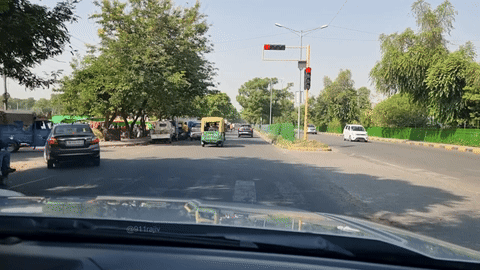
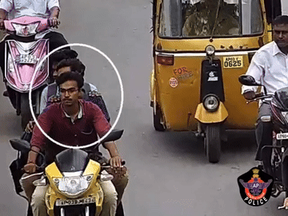
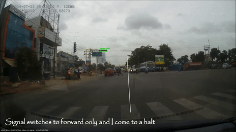

# Indian Traffic Test & Demo Videos

Eight curated benchmark video clips chosen from 45+ candidate recordings of Indian urban traffic. Each clip was verified shot-by-shot for steady camera framing, daylight illumination, clean H.264 decoding, and representative mixed traffic (two-wheelers, auto-rickshaws, buses, and cars).

All clips are hosted directly within this repository and are available to stream in-browser or download for local testing.

---

## ✦ Live Previews

<div align="center">
  <table>
    <tr>
      <td align="center"><b>Red-Light Violation Detection</b></td>
      <td align="center"><b>CCTV Triple-Riding Detection</b></td>
      <td align="center"><b>Signal Tracking & Stop Line Alignment</b></td>
    </tr>
    <tr>
      <td></td>
      <td></td>
      <td></td>
    </tr>
  </table>
</div>

---

## ✦ Video Catalog & Direct Downloads

| File | What it tests | Resolution & Duration | Size | Direct Links |
|:---|:---|:---:|:---:|:---:|
| **`01_intersection_signals_busy_1080p.mp4`** | Everything: signal state, red light, helmet, triple riding, lanes | 1080p (39 s) | 22 MB | [▶️ Watch](01_intersection_signals_busy_1080p.mp4) • [⬇️ Raw Download](https://raw.githubusercontent.com/temp-pie1207/traffic-violation-system/main/videos_final/01_intersection_signals_busy_1080p.mp4) |
| **`02_bengaluru_junction_signal_1080p.mp4`** | Helmet, triple riding, number plates, traffic signals | 1080p (2 min) | 37 MB | [▶️ Watch](02_bengaluru_junction_signal_1080p.mp4) • [⬇️ Raw Download](https://raw.githubusercontent.com/temp-pie1207/traffic-violation-system/main/videos_final/02_bengaluru_junction_signal_1080p.mp4) |
| **`03_pune_talawade_chowk_1080p.mp4`** | Red light, lanes, traffic flow from elevated fixed view | 1080p (56 s) | 29 MB | [▶️ Watch](03_pune_talawade_chowk_1080p.mp4) • [⬇️ Raw Download](https://raw.githubusercontent.com/temp-pie1207/traffic-violation-system/main/videos_final/03_pune_talawade_chowk_1080p.mp4) |
| **`04_red_light_jumpers_1080p.mp4`** | Clear red light violation, stop line crossing | 1080p (44 s) | 21 MB | [▶️ Watch](04_red_light_jumpers_1080p.mp4) • [⬇️ Raw Download](https://raw.githubusercontent.com/temp-pie1207/traffic-violation-system/main/videos_final/04_red_light_jumpers_1080p.mp4) |
| **`05_tirupati_cctv_junction_480p.mp4`** | High-density junction CCTV, helmet, triple riding | 480p (38 s) | 3.4 MB | [▶️ Watch](05_tirupati_cctv_junction_480p.mp4) • [⬇️ Raw Download](https://raw.githubusercontent.com/temp-pie1207/traffic-violation-system/main/videos_final/05_tirupati_cctv_junction_480p.mp4) |
| **`06_tirupati_cctv_triple_riding_480p.mp4`** | Close-up CCTV views of triple-riding riders | 480p (67 s) | 3.1 MB | [▶️ Watch](06_tirupati_cctv_triple_riding_480p.mp4) • [⬇️ Raw Download](https://raw.githubusercontent.com/temp-pie1207/traffic-violation-system/main/videos_final/06_tirupati_cctv_triple_riding_480p.mp4) |
| **`07_tirupati_cctv_helmet_triple_480p.mp4`** | Police CCTV footage of helmet & triple violations | 480p (92 s) | 5.0 MB | [▶️ Watch](07_tirupati_cctv_helmet_triple_480p.mp4) • [⬇️ Raw Download](https://raw.githubusercontent.com/temp-pie1207/traffic-violation-system/main/videos_final/07_tirupati_cctv_helmet_triple_480p.mp4) |
| **`08_tirupati_cctv_echallan_examples_480p.mp4`** | Multi-camera CCTV e-challan collection | 480p (3 min) | 31 MB | [▶️ Watch](08_tirupati_cctv_echallan_examples_480p.mp4) • [⬇️ Raw Download](https://raw.githubusercontent.com/temp-pie1207/traffic-violation-system/main/videos_final/08_tirupati_cctv_echallan_examples_480p.mp4) |

---

## ✦ How to Run Inference with Demo Videos

### 1. Combined E-Challan Pipeline
```bash
# Test red-light crossing detection
python echallan/run.py videos_final/04_red_light_jumpers_1080p.mp4

# Test helmet & triple riding on CCTV footage
python echallan/run.py videos_final/06_tirupati_cctv_triple_riding_480p.mp4
```

### 2. Integrated Traffic System & Web Dashboard
```bash
# Run detection and generate evidence dossier
python integrated_traffic_system.py --video videos_final/01_intersection_signals_busy_1080p.mp4 --max_frames 150 --output_dir outputs/demo_run

# Launch dashboard to inspect results
python backend_api.py --output-dir outputs/demo_run --port 8765
```

---

## ✦ Batch Download via Terminal

To download all demo videos directly via terminal:

```bash
mkdir -p demo_videos && cd demo_videos
BASE_URL="https://raw.githubusercontent.com/temp-pie1207/traffic-violation-system/main/videos_final"

for v in \
  01_intersection_signals_busy_1080p.mp4 \
  02_bengaluru_junction_signal_1080p.mp4 \
  03_pune_talawade_chowk_1080p.mp4 \
  04_red_light_jumpers_1080p.mp4 \
  05_tirupati_cctv_junction_480p.mp4 \
  06_tirupati_cctv_triple_riding_480p.mp4 \
  07_tirupati_cctv_helmet_triple_480p.mp4 \
  08_tirupati_cctv_echallan_examples_480p.mp4; do
  echo "Downloading $v..."
  curl -L -O "$BASE_URL/$v"
done
```

---

## ✦ Video Sources & Research Notes

- None of these test clips were used to train any model; they form a strictly held-out real-world validation set.
- Clips 01–04 are dashcam and elevated fixed urban recordings from Bengaluru and Pune.
- Clips 05–08 originate from the Tirupati Traffic Police CCTV network. Audio tracks have been removed for privacy.
- License: Available for private research, study, and educational evaluation.
